<div align="center">

<picture>
  <source media="(prefers-color-scheme: dark)" srcset="guias/assets/hero-dark.svg">
  
</picture>

**Você descreve o dashboard. A IA constrói. Você abre no Power BI.**

[](https://github.com/DaviMark/powerbi-workspaces/actions/workflows/ci.yml)
[](LICENSE.md)


[Guia visual](index.html) &nbsp;·&nbsp; [Começar](guias/guia-rapido.md) &nbsp;·&nbsp; [Exemplo pronto](dashboards/acme/financeiro/contas-a-receber/aging-de-titulos/LEIA-ME.md)

</div>

<br>

## Três passos

**1. Escreva.**
Preencha um formulário: o que o dashboard precisa responder, as regras de cada número e os visuais
que você imagina. Em português, como explicaria a um colega.

**2. Veja.**
A IA desenha as páginas e você abre o resultado no Power BI Desktop. Ajuste o que quiser e aprove,
antes de qualquer dado.

**3. Publique.**
A IA constrói o modelo, as consultas e os visuais. Você confere os números e publica.

<br>

## Onde fica cada coisa

| | |
|---|---|
| **O pedido** | `dashboards/<empresa>/<área>/<subárea>/<dashboard>/1-seu-pedido/` |
| **O Power BI** | `…/<dashboard>/2-power-bi/` |
| **A entrega** | `…/<dashboard>/3-entrega/` |
| **Cores e logo** | `identidade-visual/<empresa>/1-cole-aqui/` (vale para todos os dashboards da empresa) |
| **Dashboard antigo** | `refatorar/` |

As pastas numeradas são suas. `trabalho-da-ia/` é da IA e você não precisa abrir.
Pastas chamadas `nome-da-empresa`, `nome-da-area`… são modelos prontos: duplique e renomeie.

<br>

## Começar

Duplique `dashboards/nome-da-empresa/…/nome-do-dashboard`, renomeie as pastas, preencha o pedido e
diga à IA: *crie o dashboard*. Ou, pelo terminal:

```powershell
.\pbw diagnostico
.\pbw novo "Minha Empresa/Financeiro/Contas a Receber/Aging de Títulos"
.\pbw abrir aging-de-titulos
```

Preencha `1-seu-pedido/PEDIDO.md` e diga à IA: *crie o dashboard aging-de-titulos*.

Você precisa de Power BI Desktop, VS Code com uma IA (GitHub Copilot, Claude Code, Cursor ou Codex),
Python 3.11 ou superior e Git.

> **Clone numa pasta curta**, como `C:\pbw`. O Power BI Desktop não abre arquivos com caminho de 260
> caracteres ou mais, e a Área de Trabalho, o OneDrive e o SharePoint sincronizado deixam o caminho comprido.
> Se aparecer *"o caminho especificado… é muito longo"*, abra com `pbw abrir`: ele contorna o limite.
> [Detalhes](guias/faq.md).

<br>

## O que já vem pronto

**Um padrão visual de produto.** Barra lateral com a marca, navegação entre páginas, cartões com
variação contra o mês anterior, cores da empresa. Nada com cara de relatório genérico.

**Documentação dentro do relatório.** Toda métrica explicada numa página do próprio Power BI.

**Segurança.** Nenhum dado e nenhuma senha no repositório. Verificado a cada commit.

**Qualquer IA.** As regras estão num único arquivo, `AGENTS.md`, que todas as IAs do VS Code leem.

<br>

## Com a skill Power BI Architect

O Workspaces define **onde e quando**: pastas, etapas, aprovações. A skill
[Power BI Architect](https://github.com/DaviMark/powerbi-architect) ensina à IA **como**, no nível de um
especialista: modelagem, DAX e design de relatórios. Ela também mantém um mapa do repositório, com
o qual a IA responde sobre seus dashboards gastando muito menos.
Instale as duas: [guias/ia-no-vscode.md](guias/ia-no-vscode.md). O `pbw skill` mostra se ela está
instalada e como atualizar; com ela, `pbw auditar` dá uma nota de design a cada página e `pbw previa`
mostra as páginas no navegador, sem o Power BI.

<br>

## Saiba mais

[Guia rápido](guias/guia-rapido.md) &nbsp;·&nbsp;
[Comandos](guias/comandos.md) &nbsp;·&nbsp;
[Padrão visual](guias/padrao-visual.md) &nbsp;·&nbsp;
[Conexões](conexoes/LEIA-ME.md) &nbsp;·&nbsp;
[Identidade visual](identidade-visual/LEIA-ME.md) &nbsp;·&nbsp;
[Dashboards antigos](refatorar/LEIA-ME.md) &nbsp;·&nbsp;
[Publicação](guias/publicacao.md) &nbsp;·&nbsp;
[Regras](guias/governanca.md) &nbsp;·&nbsp;
[Perguntas frequentes](guias/faq.md) &nbsp;·&nbsp;
[Segurança](.github/SECURITY.md) &nbsp;·&nbsp;
[English](guias/README.en.md)

<br>

<sub>[Licença MIT](LICENSE.md) · Power BI e Microsoft Fabric são marcas da Microsoft. Projeto independente.</sub>
