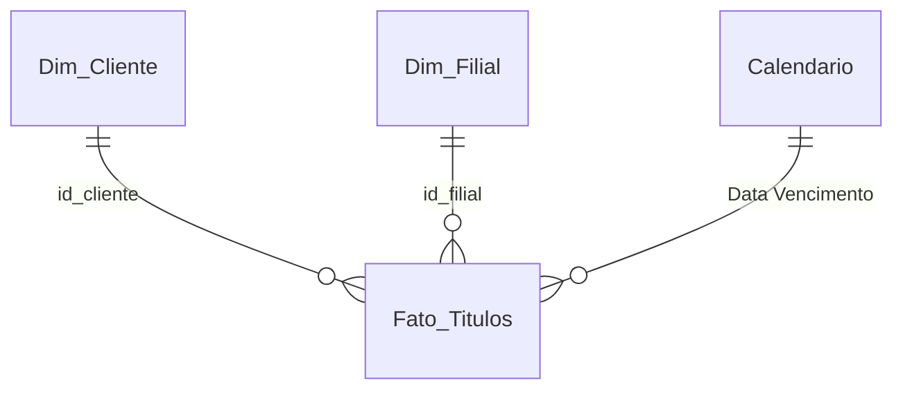

# Desenho — Aging de Títulos

> **A IA propõe, você aprova** (Gate 1). Ao terminar este arquivo a IA roda `pbw prototipo`:
> abra o `.pbip` (`pbw abrir aging-de-titulos`) e veja as páginas antes de qualquer dado.

## 1. Modelo

### Star schema

### Tabelas

| Tabela | Tipo | Grão (1 linha = …) | Chave | Colunas importadas | Fonte |
|---|---|---|---|---|---|
| Fato Titulos | fato | parcela de título | id_parcela | 12 | `trabalho-da-ia/sql/Fato Titulos.sql` |
| Dim Cliente | dimensão | cliente | id_cliente | 4 | `trabalho-da-ia/sql/Dim Cliente.sql` |
| Dim Filial | dimensão | filial | id_filial | 3 | `trabalho-da-ia/sql/Dim Filial.sql` |
| Calendario | dimensão (DAX) | dia | Data | 8 | calculada |

### O que NÃO vamos importar (e por quê)

- Colunas de auditoria da view (`usuario_inclusao`, `dt_alteracao`, …) — não respondem nenhuma pergunta.
- Observações em texto livre — alto custo de memória, sem uso analítico.
- Títulos cancelados (`status = 'C'`) — regra de negócio, filtrados no SQL.
- Nome/CNPJ completo do cliente — o nome fantasia basta; reduz exposição de dados.

### Decisões de modelagem

- Relacionamento ativo com `Calendario` pela **data de vencimento** (a pergunta é "quando vence/venceu").
- Faixa de atraso calculada no SQL na data da carga (atualização diária torna isso exato o suficiente).
- Auto date/time desligado; relacionamentos 1:* de dimensão → fato, direção única.

### Aprovação

- [x] Aprovado por: Coordenação de Contas a Receber (fictício) — Gate 1

## 2. Métricas

| Pasta | Medida | Definição de negócio | Fórmula (resumo) | Formato | Validada por |
|---|---|---|---|---|---|
| Valores | Saldo em Aberto | Valor ainda não recebido (parcela − pago), sem cancelados | `SUM(Saldo Aberto)` | R$ #,0 | Contas a Receber |
| Valores | Valor Vencido | Saldo em aberto com vencimento anterior à data da carga | `[Saldo em Aberto]` com `Dias Atraso > 0` | R$ #,0 | Contas a Receber |
| Valores | Valor a Vencer | Saldo em aberto com vencimento hoje ou no futuro | `[Saldo em Aberto]` com `Dias Atraso <= 0` | R$ #,0 | Contas a Receber |
| Indicadores | % Vencido | Valor vencido ÷ saldo em aberto | `DIVIDE` | 0.0% | Contas a Receber |
| Indicadores | Prazo Médio de Atraso (dias) | Média de dias de atraso ponderada pelo saldo vencido | `SUMX(saldo × dias) ÷ vencido` | 0 | Contas a Receber |
| Contagens | Clientes Inadimplentes | Clientes com ao menos uma parcela vencida em aberto | `DISTINCTCOUNT(id_cliente)` | #,0 | Contas a Receber |
| Contagens | Parcelas em Aberto | Parcelas não pagas | `COUNTROWS` sem data de pagamento | #,0 | Contas a Receber |
| Textos | Título Visão Geral | Título-conclusão da página | texto dinâmico | — | BI |

## 3. Páginas

### Visão Geral
**Pergunta:** quanto do que temos a receber já venceu, onde está e com quem?

| Zona | Visual | Campos | Por que este visual |
|---|---|---|---|
| Subtítulo | Cartão | [Título Visão Geral] | a conclusão em uma frase, antes de qualquer gráfico |
| KPIs | Cartão | [Saldo em Aberto] | leitura em 3 segundos |
| KPIs | Cartão | [Valor Vencido] | leitura em 3 segundos |
| KPIs | Cartão | [% Vencido] | leitura em 3 segundos |
| KPIs | Cartão | [Prazo Médio de Atraso (dias)] | leitura em 3 segundos |
| Explicação | Colunas agrupadas | Fato Titulos[Faixa Atraso] × [Valor Vencido] | ordem natural das faixas, comparação de magnitude |
| Explicação | Barras agrupadas | Dim Cliente[Cliente] × [Valor Vencido] (desc) | ranking com nomes longos legíveis |
| Tendência | Colunas agrupadas | Calendario[Ano-Mês] × [Saldo em Aberto] | concentração de vencimentos no tempo |
| Filtro | Segmentação (lista suspensa) | Dim Filial[Regional] | único corte pedido no pedido |

### Documentação (obrigatória)
Catálogo de métricas + cargas (gerado do modelo).

## 4. Decisões

### ADR-001 — Estrutura inicial
- **Decisão:** PBIP (PBIR + TMDL), star schema, SQL na fonte, conexão `acme-erp`.

### ADR-002 — Faixa de atraso no SQL
- **Contexto:** a faixa depende da data de referência.
- **Decisão:** calcular no SQL com `GETDATE()` na carga diária, em vez de coluna calculada/DAX por linha.
- **Consequência:** modelo leve e simples; a faixa reflete a data da última carga (exibida no cabeçalho).

### ADR-003 — Sem RLS
- **Contexto:** público é a equipe financeira inteira, sem segregação por filial.
- **Decisão:** sem RLS; classificação `internal`. Rever se o painel for aberto para gerentes de filial.

### ADR-004 — Nenhum visual customizado
- Todos os visuais pedidos são atendidos por visuais nativos (cartão, colunas, barras, segmentação).
