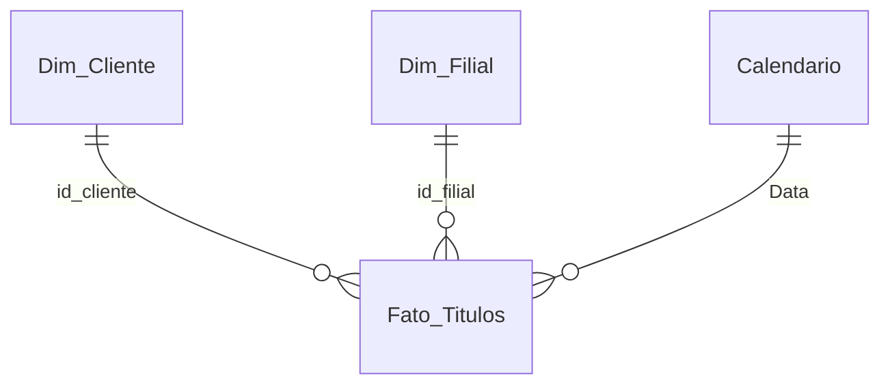

<!-- GERADO por `pbw documentar`. Não edite à mão: altere o modelo e rode de novo. -->

# Dicionário técnico do modelo

Tabelas: **4** · Medidas: **9** · Relacionamentos: **3**

## Diagrama (star schema)



## Tabelas

### _Cargas

_Tipo: calculada (DAX) · import_

Cargas do modelo: tabelas vindas da fonte, modo de armazenamento e último refresh.
A descrição de cada tabela (///) deve trazer: fonte, arquivo SQL, grão e conexão.

| Coluna | Tipo | Oculta | Descrição |
|---|---|---|---|
| Tabela | string |  |  |
| Descrição | string |  |  |
| Armazenamento | string |  |  |
| Última Carga | dateTime |  |  |

### _Documentacao

_Tipo: calculada (DAX) · import_

Catálogo vivo das métricas (INFO.VIEW.MEASURES). Recalculado a cada atualização.
Alimenta a página 'Documentação'. Descrições vêm do /// de cada medida no TMDL.

| Coluna | Tipo | Oculta | Descrição |
|---|---|---|---|
| Tabela | string |  |  |
| Pasta | string |  |  |
| Medida | string |  |  |
| Descrição | string |  |  |
| Expressão DAX | string |  |  |
| Formato | string |  |  |

### _Medidas

_Tipo: calculada (DAX) · import_

Tabela de medidas do modelo. Nenhuma coluna visível: só medidas, organizadas em pastas.
A coluna oculta [Data Carga] registra o momento do último refresh (UTC-3h).

| Coluna | Tipo | Oculta | Descrição |
|---|---|---|---|
| Data Carga | dateTime | sim |  |

### Calendario

_Tipo: calculada (DAX) · import · tabela de datas_

Dimensão calendário (DAX, sem Power Query). Período = anos cobertos pelos vencimentos da fato.
Marcada como tabela de datas. Auto date/time está desligado no modelo.

| Coluna | Tipo | Oculta | Descrição |
|---|---|---|---|
| Data (chave) | dateTime |  |  |
| Ano | int64 |  |  |
| Mês Nº | int64 |  |  |
| Mês | string |  |  |
| Ano-Mês | string |  |  |
| Trimestre | string |  |  |
| Dia da Semana Nº | int64 |  |  |
| Dia da Semana | string |  |  |

### Dim Cliente

_Tipo: fonte · import_

Clientes com pelo menos um título.
Grão: 1 linha por cliente · Fonte: trabalho-da-ia/sql/Dim Cliente.sql · Conexão: acme-erp

| Coluna | Tipo | Oculta | Descrição |
|---|---|---|---|
| id_cliente | int64 | sim |  |
| Cliente | string |  |  |
| Segmento | string |  |  |
| UF | string |  |  |

### Dim Filial

_Tipo: fonte · import_

Filiais e regionais.
Grão: 1 linha por filial · Fonte: trabalho-da-ia/sql/Dim Filial.sql · Conexão: acme-erp

| Coluna | Tipo | Oculta | Descrição |
|---|---|---|---|
| id_filial | int64 | sim |  |
| Filial | string |  |  |
| Regional | string |  |  |

### Fato Titulos

_Tipo: fonte · import_

Parcelas de títulos a receber (abertas e liquidadas), sem cancelados.
Grão: 1 linha por parcela · Fonte: trabalho-da-ia/sql/Fato Titulos.sql · Conexão: acme-erp

| Coluna | Tipo | Oculta | Descrição |
|---|---|---|---|
| id_parcela | int64 | sim |  |
| id_cliente | int64 | sim |  |
| id_filial | int64 | sim |  |
| Data Emissão | dateTime |  |  |
| Data Vencimento | dateTime |  |  |
| Data Pagamento | dateTime |  |  |
| Valor Parcela | decimal | sim |  |
| Valor Pago | decimal | sim |  |
| Saldo Aberto | decimal | sim |  |
| Dias Atraso | int64 | sim |  |
| Faixa Atraso | string |  | Faixa de atraso na data da carga: A vencer, 1–30 … > 180, Liquidado. |
| Faixa Ordem | int64 | sim |  |

## Medidas

### Contagens

#### [Clientes Inadimplentes]

Clientes com pelo menos uma parcela vencida em aberto.

Formato: `#,0` · Tabela: `_Medidas`

```dax
CALCULATE ( DISTINCTCOUNT ( 'Fato Titulos'[id_cliente] ), 'Fato Titulos'[Dias Atraso] > 0 )
```

#### [Parcelas em Aberto]

Quantidade de parcelas ainda não pagas.

Formato: `#,0` · Tabela: `_Medidas`

```dax
CALCULATE ( COUNTROWS ( 'Fato Titulos' ), ISBLANK ( 'Fato Titulos'[Data Pagamento] ) )
```

### Indicadores

#### [% Vencido]

Participação do valor vencido no saldo em aberto.

Formato: `0.0%` · Tabela: `_Medidas`

```dax
DIVIDE ( [Valor Vencido], [Saldo em Aberto] )
```

#### [Prazo Médio de Atraso (dias)]

Média de dias de atraso ponderada pelo saldo vencido.

Formato: `0` · Tabela: `_Medidas`

```dax
DIVIDE (
    SUMX ( FILTER ( 'Fato Titulos', 'Fato Titulos'[Dias Atraso] > 0 ), 'Fato Titulos'[Saldo Aberto] * 'Fato Titulos'[Dias Atraso] ),
    [Valor Vencido]
)
```

### Textos

#### [Título Visão Geral]

Título-conclusão da página: quanto do saldo está vencido.

Formato: `—` · Tabela: `_Medidas`

```dax
"Vencido: " & FORMAT ( [Valor Vencido], "R$ #,0" ) & " (" & FORMAT ( [% Vencido], "0.0%" ) & " do saldo em aberto)"
```

### Valores

#### [Saldo em Aberto]

Valor ainda não recebido (parcela − pago), títulos cancelados excluídos.

Formato: `\R\$ #,0` · Tabela: `_Medidas`

```dax
SUM ( 'Fato Titulos'[Saldo Aberto] )
```

#### [Valor Vencido]

Saldo em aberto com vencimento anterior à data da carga.

Formato: `\R\$ #,0` · Tabela: `_Medidas`

```dax
CALCULATE ( [Saldo em Aberto], 'Fato Titulos'[Dias Atraso] > 0 )
```

#### [Valor a Vencer]

Saldo em aberto com vencimento hoje ou no futuro.

Formato: `\R\$ #,0` · Tabela: `_Medidas`

```dax
CALCULATE ( [Saldo em Aberto], 'Fato Titulos'[Dias Atraso] <= 0, ISBLANK ( 'Fato Titulos'[Data Pagamento] ) )
```

### _Sistema

#### [Atualizado em]

Texto pronto para o cabeçalho das páginas: "Atualizado em dd/mm/aaaa hh:mm".

Formato: `—` · Tabela: `_Medidas`

```dax
"Atualizado em " & FORMAT ( MAX ( '_Medidas'[Data Carga] ), "dd/mm/yyyy hh:nn" )
```

## Cargas (Power Query)

| Tabela | Modo | Etapas | Origem |
|---|---|---|---|
| Dim Cliente | import | 1 | SQL nativo |
| Dim Filial | import | 1 | SQL nativo |
| Fato Titulos | import | 1 | SQL nativo |
