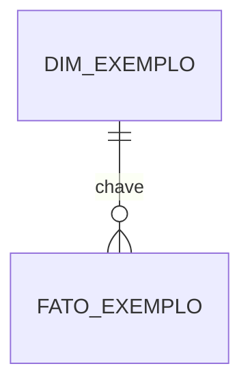

# Desenho — Nome do Dashboard

> **A IA escreve este arquivo a partir de `1-seu-pedido/PEDIDO.md`; você aprova** (Gate 1).
> Ao terminar, a IA roda `pbw prototipo`:
> abra o `.pbip` (`pbw abrir nome-do-dashboard`) e veja as páginas antes de qualquer dado.
> Nada de SQL ou medidas é implementado antes da sua aprovação.

## 1. Modelo

| Tabela | Tipo | Grão (1 linha = …) | Chave | Colunas importadas | Consulta |
|---|---|---|---|---|---|
| TODO | fato | TODO | TODO | só as necessárias | `sql/….sql` |

**O que NÃO vamos importar (e por quê)**

- TODO

## 2. Métricas

> A definição de negócio vira a descrição da medida e aparece na página **Documentação**.

| Pasta | Medida | Definição de negócio | Fórmula (resumo) | Formato |
|---|---|---|---|---|
| TODO | TODO | TODO | TODO | `#,0` |

## 3. Páginas

> Uma página = uma pergunta. Uma linha por visual. `pbw prototipo` desenha estas páginas no `.pbip`.
> Zonas: **Filtro** (topo, à direita) · **KPIs** (linha de cartões) · **Tendência** / **Explicação**
> (área principal) · **Detalhe** (tabela embaixo).

### Visão Geral
**Pergunta:** TODO

| Zona | Visual | Campos | Por que este visual |
|---|---|---|---|
| KPIs | Cartão | [Medida principal] | leitura em 3 segundos |
| Tendência | Colunas | Calendario[Ano-Mês] × [Medida principal] | evolução no tempo |
| Explicação | Barras | Dimensão × [Medida principal] | ranking |
| Filtro | Segmentação | Dimensão[Atributo] | corte pedido no pedido |

### Documentação (obrigatória)
Gerada automaticamente: catálogo de métricas + cargas.

## 4. Decisões

> Registro curto de cada escolha não óbvia: contexto → decisão → consequência.
> Visual customizado (.pbiviz) só entra com uma decisão aqui explicando por que nenhum visual nativo atende.

- **D1 — Estrutura inicial (2026-11-21):** PBIP (relatório + modelo em texto), star schema, SQL na fonte,
  conexão `sqlserver.example`.

## Aprovação (Gate 1)

- [ ] Aprovado por: ____________ em ____/____/______
