<div align="center">

<picture>
  <source media="(prefers-color-scheme: dark)" srcset="assets/hero-dark.svg">
  
</picture>

**AI-built Power BI dashboards, governed as code — made for data analysts.** · [Português](../README.md)

</div>

You describe **what** the business needs. Your AI designs the model and writes the SQL, DAX and report.
At **every step** there is a `.pbip` you can open in Power BI Desktop to see how it is going — from the
first prototype to delivery. **Power BI Workspaces** makes sure everything lands **in the same standard,
in the right place, documented, and with no data or passwords in Git** — with any AI in VS Code
(Copilot, Claude Code, Cursor, Codex, Gemini).

## What you get

- **One folder per dashboard, always the same shape** — numbered folders are the analyst's,
  `trabalho-da-ia/` is the AI's: `1-seu-pedido/` (`PEDIDO.md` form with business rules and wanted
  visuals + `anexos/`), `2-power-bi/` (`<Name>.pbip`, double-click to open), `3-entrega/` (the `.pbit`
  to publish), `trabalho-da-ia/` (SQL, design, checks, dictionary, history, `ficha.toml`).
- **One visual identity per company** — paste brand material in `identidade-visual/<company>/1-cole-aqui/`;
  the theme is applied automatically to every dashboard of that company.
- **Always openable** — `pbw novo` creates a PBIP that opens immediately; at design time
  `pbw prototipo` draws every planned page as grey placeholder boxes on the 8-px grid; `pbw validar`
  fails any dashboard whose PBIP would not open.
- **One contract for every AI** — `AGENTS.md` with workflows (new, refactor, brand, connection, document),
  two human approval gates and a Definition of Done.
- **Connection profiles** — SQL Server/Fabric, SAP HANA, BigQuery, PostgreSQL, Snowflake, Databricks,
  Oracle, MySQL. A dashboard points to a profile; the CLI generates Power Query parameters and **one
  single step** per table from `trabalho-da-ia/sql/*.sql`.
- **Self-documenting reports** — every report ships a *Documentação* page built from
  `INFO.VIEW.MEASURES/TABLES`, plus a living `LEIA-ME.md` and a generated data dictionary.
- **Legacy refactoring** — drop a `.pbit` in `refatorar/…`; `pbw refatorar` reads it offline
  (no Power BI, no data) and reports Power Query steps, unused columns, bidirectional relationships,
  undocumented measures… then the AI rebuilds it in the standard.
- **Guardrails** — governance rules, secret/data scanner, pre-commit hook, CI on Linux + Windows.
- **Zero dependencies, zero network** — Python 3.11+ standard library only. No telemetry.

## Quick start

```powershell
# "Use this template" → private repo for your company, clone it into a SHORT folder (e.g. C:\pbw),
# then in the VS Code terminal:
.\pbw diagnostico
.\pbw instalar-hooks
.\pbw novo "My Company/Finance/Receivables/Aging"
.\pbw abrir aging
```

Fill `1-seu-pedido/PEDIDO.md`, then ask your AI: **"create the dashboard aging"**.
Commands are in Portuguese; English names still work (`pbw new`, `pbw open`, `pbw validate`…).

### How to create a `.pbit`
Power BI Desktop › **File › Export › Power BI template** › save as `<Name>.pbit`
(model, measures, queries and layout — no data rows; *Enter data* tables are embedded and flagged by `pbw seguranca`).

Human-facing docs are in Portuguese; AI-facing files are in English. Set `[project] language` in
`workspaces.toml` to have the AI write documentation in your language.

**Windows path limit.** Power BI Desktop cannot read files whose full path has 260+ characters, and
PBIR folders are deep. Clone into a short folder; if Desktop says the path is too long, `pbw abrir` opens
the project through a short virtual drive (`subst`) pointing at the same files.

Pairs with the **[Power BI Architect](https://github.com/DaviMark/powerbi-architect)** skill
(`pbw skill` shows how to install it; `pbw auditar` and `pbw previa` use its scripts).
[MIT licensed](../LICENSE.md).
